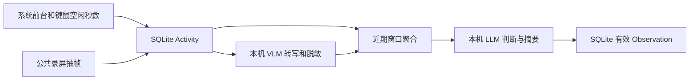

# 0009 · 独立 Observation v2

桌面实时采样与文档记忆的后续决策见 [0011](0011-multimodal-document-observation.md)。

状态为独立实现，设计来自 [Notion ADR](https://app.notion.com/p/420eb246ea0681169f3af32e46ee9ce5)。



- Activity 按 Work Review 的轮询、连续片段和截图触发设计实现。相同的应用或页面延长当前片段，锁屏、会话切换和采样中断切断计时。macOS 轮询 1.5 秒，常规截图间隔 30 秒，应用和页面切换有独立冷却。系统采集键鼠综合空闲秒数。活动行先提交，视觉结果按实际采集时间异步补齐。[Work Review 采集循环](https://github.com/wm94i/Work-Review/blob/main/src-tauri/src/main.rs)
- VLM 分开调用。SQLite 保存场景分类、经程序二次过滤的短转写和摘要，以及视觉处理结果。本机 Ollama 为默认路径。选择云端视觉时，接收方在文字脱敏之前收到经过来源检查的窗口图像。脱敏依赖模型和程序过滤，覆盖范围需用有标注的样本衡量。
- 默认聚合最近 60 秒。程序计算可观察时长、前台和屏幕的各自切换、输入恢复与信号时效。独立文本模型输出活动类别和状态摘要。默认 TTL 为 15 秒，支撑判断的证据较早失效时可缩短。实时模式启动时发起首轮状态请求，此后默认至少间隔 30 秒发起一轮，每轮最多落库一条 Observation。模型失败或返回结果已过时时，本轮改为发布当前的 `unknown`。两轮之间的场景变化或证据过期会使旧结果失效，有效 Observation 可能暂时为空。
- 有效 Observation 字段为 `activity_kind`、`state`、`summary`、`reason_codes`、`observed_at`、`valid_until`、`context_revision`。录屏可以给出活动类别，纯录屏没有真实系统交互信号时可打扰状态为 `unknown`。SQLite 单独保存 Activity、屏幕观测和历次状态。使用独立 CLI 验收。

## 运行

准备 FFmpeg 和禁用云模型的本机 Ollama，拉取两个模型。录屏回放使用新建的数据库，实时模式可继续使用同一个实时数据库。

```sh
ollama pull qwen3-vl:2b-instruct
ollama pull qwen2.5:1.5b
python -m deskpet.observation_v2 replay public-recording.mp4 \
  --database /tmp/mochi-observation-replay.sqlite --interval-s 4 --max-frames 8 --require-models
```

回放以视频帧的展示时间驱动虚拟时钟，起点对应 `2000-01-01T00:00:00Z`。每个抽帧间隔有一条 Activity，缺少系统元数据时留空。`--require-models` 要求每帧均产生有效的 VLM 结果和经校验的 LLM 结果。SQLite 中的捕获成功与 VLM 成功由不同字段表示。

```sh
python -m deskpet.observation_v2 live --database /tmp/mochi-observation-live.sqlite --duration-s 65
```

实时模式默认采集系统元数据。`--capture-screen` 开启本机主屏采集，要求操作系统已明确报告屏幕解锁。macOS 支持对部分 Chromium 浏览器用 `--browser-metadata` 启用页面检测，可能需要 Automation 授权。可检测的私密窗口或登录、支付等敏感标题会跳过截图并省略标题、域名。1Password、Bitwarden 和 Keychain 默认排除。可重复使用 `--exclude-app` 和 `--exclude-domain` 排除应用及已识别域名。平台不给出私密模式信号时，判断依赖窗口标题提示。采集后会重新确认前台和会话是否一致。主屏画面可能包含其他窗口。采样结束后会收尾已开始的模型调用，实时模型请求的超时上限取 TTL 和配置超时中的较小值。Windows 和 Linux 原生采样需要各自的桌面环境复测。

## System 2 的 Observation 上下文

实时采集复用同一个本地 SQLite。采集程序重启时使上一轮当前记录失效，并保留已发布历史。SQLite 记录发布时间和上下文失效时刻。回放使用独立数据库。旧日志可查询历史。

```sh
python -m deskpet.observation_v2 context --database /tmp/mochi-observation-live.sqlite
```

上下文按同一 `as_of` 读取，包含 `current`、`current_status` 和过去一小时的 `history`。历史保留最近三条、最多八个简表段、最近八个断档边界及截断前统计。相邻同活动类别、同状态且间隔不超过 45 秒的记录合并，摘要取段内最后一条非空值。超过八段时保留最近四段，其余位置优先较早的 `available` 或 `away`，其次活动类别变化，同优先级选较新的。

在工作台代码中以 `build_environment(observation_database=...)` 启用此读取路径，Planner 实现 `ObservationContextPlanner.plan_with_context` 接收整个快照。M0 回放入口也接受 `--observation-database`，查询使用该场景的虚拟时钟。现有脚本 Planner 用新鲜的当前状态判断可打扰性；软提醒执行前复核当前状态、版本和有效期。到期兜底继续由任务服务处理。首版传递现有描述性 `summary`，事实校验见 Notion 子文档。


录像及标注归 GUI-World 数据集，授权为 CC BY 4.0。用于复跑的片段有 [VS Code 与 Docker Compose](https://huggingface.co/datasets/ONE-Lab/GUI-World/blob/main/software/212.mp4)、[编辑器与浏览器切换](https://huggingface.co/datasets/ONE-Lab/GUI-World/blob/main/multi/70.mp4)、[打开 Bilibili](https://huggingface.co/datasets/ONE-Lab/GUI-World/blob/main/website/76.mp4) 和 [TikTok 视频播放](https://huggingface.co/datasets/ONE-Lab/GUI-World/blob/main/website/175.mp4)。[数据集与许可](https://huggingface.co/datasets/ONE-Lab/GUI-World)

## v1.2 桌面接入与隐私设置

日常桌宠通过 `python -m deskpet` 启动。数据目录下的 `observation.sqlite3` 保留观测，`business.sqlite3` 保存事项、专注和模型设置。桌宠启动独立采集进程并监督其退出。截图初始关闭；设置面板支持暂停采集、单独选择视觉与状态模型、配置应用与域名排除。

同轮截图和文本请求在证据有效期内对齐。等待视觉结果超时后使用仍有效的系统信号。实时判断按会话和连续采集区间筛选画面、输入与切换，明确锁屏使旧的当前观测失效。按发布游标、生产者世代、同一系统启动周期的单调时间读取实时头部；历史回放继续使用指定的 `as_of`。可选的观测库不可读时，柔性判断等待，硬截止由本地服务继续处理。

最近一小时的每个压缩段同时保留 `summary` 和 `summary_samples`。代表样本取第一条非空描述及最后一条与其不同的描述，携带各自的观测时刻。云端 System 2 关闭活动摘要分享时，代表样本和其他观测文本一起从出站投影移除。

设置里的截图同意、发往云端状态模型的脱敏屏幕文字、发往云端 System 2 的活动摘要按接收方管理。云端状态模型默认只接收允许的结构化字段。不满足窗口来源或排除条件的图像跳过。命令行通过 `python -m deskpet.observation_v2 cloud --help` 查看配置入口，使用 `live --cloud-settings PATH` 或 `replay --cloud-settings PATH` 选择已有设置库。[补充设计与验收](https://app.notion.com/p/421eb246ea0681c398f4ec863dcb69e2)

使用独立命令行接入时，通过 `cloud --cloud-settings PATH configure ROLE` 指定模型，`credential ROLE` 将密钥写入本机凭据存储，`verify ROLE` 用合成数据测试能力。开启额外发送权限时，`consent ROLE allow --recipient BASE_URL` 需要填写当前接收方地址。视觉探针也需要该接收方的图像许可。状态角色关闭文字权限时仍能处理结构化证据。授权文字限定为可校验的通用界面标签和场景描述。回放画面由本机 Ollama 处理，可为状态角色单独选择已验证的模型。

使用同一组四段 GUI-World 录屏复测本地路径，每四秒抽帧，共 14 帧。两个模型均完成 14 次处理。14 条发布状态均为 `unknown`，活动类别分别为 work 3 条、leisure 5 条、unknown 6 条。TikTok 片段有一条文字摘要推断用户离开电脑，录屏无法支持该说法。当前授权逻辑只读取经程序校验的状态和系统证据。摘要事实校验另有后续设计。

## 原独立版本的验收结果

用 `qwen3-vl:2b-instruct` 和 `qwen2.5:1.5b` 以 4 秒间隔回放四段公开录屏，14 帧均取得有效 VLM 与 LLM 响应。SQLite 完整性、外键、采集时间绑定和空系统字段已检查。纯录屏的可打扰状态全部为 `unknown`。

| 片段 | 抽帧数 | 活动类别 |
| --- | ---: | --- |
| VS Code 与 Docker Compose | 3 | 2 帧 `work`，1 帧 `unknown` |
| 编辑器与浏览器切换 | 5 | 1 帧 `work`，4 帧 `unknown` |
| TikTok 视频播放 | 3 | 3 帧 `leisure` |
| 打开 Bilibili | 3 | 2 帧 `leisure`，1 帧 `unknown`；页面入口的分类可再校准 |

合成画面中的姓名、邮箱、路径和密码值均未出现在 VLM 输出中。真实文本模型在合成 OS 信号上分别给出持续编辑 `working`、短暂切换 `unknown`、锁屏 `away`。真实 macOS 冒烟测了无截图的原生采集。原生截图的进程内采集与切窗丢弃由自动化测试覆盖。代码回归共 473 项。
