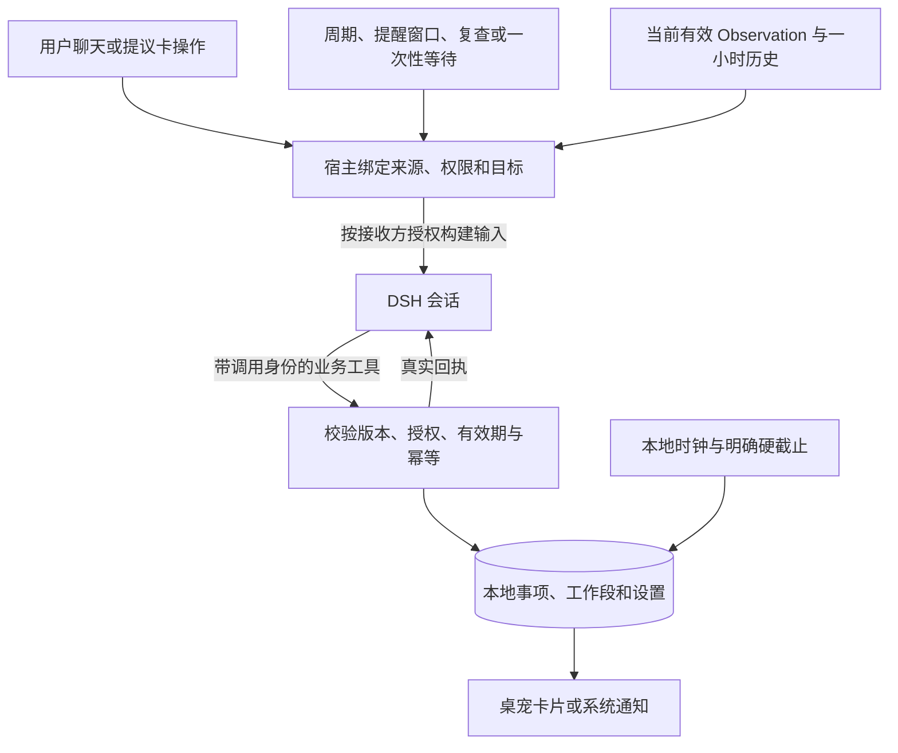

# 0010 · Mochi System 2 的思考与执行

聊天和后台的最新决策边界见 [ADR 0012](0012-system2-semantic-decisions-proposal.md)。

日常桌宠、命令和定时唤醒通过同一套业务服务访问事项、提醒和工作段。DSH 负责一次推理需要哪些工具调用，Mochi 保存业务事实、校验授权并实际执行。相关产品决策见 [System 2 v1.2](https://app.notion.com/p/421eb246ea0681e2a730fa9b940babf8) 和[打扰机会、Observation 与 UI 的补充 ADR](https://app.notion.com/p/421eb246ea0681c398f4ec863dcb69e2)。

**运行边界。** 使用独立 DSH home 和项目专用 profile。用户消息与后台触发有各自的准入身份。观察文本作为推理输入，写操作权限来自真实的用户命令、已接受的安排或宿主限定的后台权限。程序跟踪工作步骤、调用和结果，将用户可见的答复关联到对应消息。后台的安静决定保存在本地。

**并发和改口。** 项目锁定 DSH SDK 与原生运行时 `0.2.2rc2`。实测在旧工具正在运行时，原生 `steer` 可以先接收改口，再执行先前的工具。宿主因此串行准入独立写意图，并在 SQLite 写入事务内检查来源、版本和用户是否已改口。新消息仍可排队和撤销旧意图，Qt 主线程继续接受操作。

**计时回执。** 用户说“改成 40 分钟”时，宿主根据当前工作段绑定总时长 2,400 秒。“再加 10 分钟”则绑定增加 600 秒。只有工具或本地命令返回有效回执，聊天才显示调整成功。对“还剩多久”的直接查询，聊天与面板使用同一份计时状态。后台推断出的调时建议要经过用户确认。

**打扰权。** 运行中的专注抑制普通弹性提醒。具有具体时效的事项只能在允许窗口内、观测新鲜且业务规则允许时低打扰呈现。普通提醒沿用空档配额。开启自动番茄钟后，新的专注提议可以在有效的 working 或 available 状态下独立展示，头顶气泡提供「接受」和「拒绝」，聊天打开或工具栏折叠时也可直接确认。投递时重新读取有效观测，同一采集代内从原观测到当前观测的状态一致即可沿用提议；状态变化或采集重启需要重新判断。明确最早、最迟和过期边界属于用户约定；估算窗口结束触发复评。硬截止、确定性手动操作和已接受的计时安排由本地服务负责。

**执行与恢复。** 命令带稳定标识、对象版本和来源，重复投递查询原结果。普通显示之前再次核对当前观测。正在等待观测的业务记录使用发布游标恢复，历史回放使用显式时间点。OS 登记、Qt 实际绘制、用户确认分别记账，设备恢复先核对交付状态。跨渠道的同一提醒只允许一方主动呈现。

桌宠展开时，同刻到期的多项提醒合成一张卡，每项各自确认。桌宠收起后如果由系统通知负责，每个提醒轮次保留独立登记，以便单项改期、撤回和重启对账。同一批到期的通知最多向操作系统申请一次发声。

**模型与隐私。** System 2 的云端路由与 Observation 两个角色分开配置。工具回合、恢复会话及辅助模型请求均经过同一受控出口。撤权或更换接收方后隔离旧模型会话。活动摘要分享关闭时，宿主移除当前摘要、历史摘要和代表描述。摘要的事实校验另行实施。

System 2 默认提供方为阿里云百炼，模型 ID 为 `qwen4-max`。桌宠预填北京按量服务的 OpenAI 兼容 Base URL。非北京地域可填同地域业务空间的官方地址。用户在本机输入 API Key 并验证流式工具调用，SQLite 仅保存系统凭据引用。已有配置切换接收方时重新输入密钥，独立控制活动摘要分享。[模型说明](https://help.aliyun.com/zh/model-studio/qwen4-max) · [官方端点](https://help.aliyun.com/zh/model-studio/base-url)

一次用户请求或后台唤醒可能产生连续多次工具调用。为了让模型接续前一步推理，网关在内存中按工具调用 ID 暂存 `reasoning_content`，续调时回传对应片段，结束本次请求就释放。DSH 会话保留可见答复和工具结果，以便下次继续处理。[百炼 Chat Completions 协议](https://help.aliyun.com/zh/model-studio/qwen-api-via-openai-chat-completions/)

设计验收以 [01–31 用例](https://app.notion.com/p/421eb246ea06813e9d2acbfdb672f16a) 和[补充 ADR 的 G01–G08](https://app.notion.com/p/421eb246ea0681c398f4ec863dcb69e2) 为准。

### 实现与复验入口

| 契约行为 | 可运行的验证 |
| --- | --- |
| 01–06、21、22、26、31 及 G01、G02。合并唤醒、观测撤销、弹性机会和硬截止分别计时 | [调度器用例](../../tests/test_system2_scheduler.py)、[系统交界处的业务用例](../../tests/test_system2_business_integration.py) |
| 07–10、17、23–25、28–30 及 G07、G08。将用户改口、提议、时间归属、事项和习惯写入同一份业务状态 | [宿主消息和改口](../../tests/test_system2_host.py)、[工具及提议](../../tests/test_system2_tools.py)、[事项和历史归属](../../tests/test_system2_items.py)、[休眠与计时恢复](../../tests/test_persistent_work_sessions.py) |
| 11–13、19、20、27。分别核对投递意图、系统登记、绘制和响应。取消或失效后，在最终绘制和发声前再检查 | [桌面渠道与系统登记](../../tests/m0/test_desktop_presentation.py)、[真实 Qt 的离屏投递](../../tests/m0/test_desktop_reminder_delivery.py) |
| 02、14–18 及 G03–G06。当前态与历史有不同有效期，三个模型角色分别限制数据出站 | [实时采样与墙钟回拨](../../tests/test_observation_v2_realtime.py)、[历史代表描述](../../tests/test_history_summary_samples.py)、[Observation 传输测试](../../tests/test_observation_v2_cloud.py)、[实际 DSH 进程与回环模型端点](../../tests/test_system2_dsh.py) |

在仓库根目录运行 `uv sync --locked --extra dev`，然后运行 `uv run --locked pytest -q`。Qt 支持离屏测试。DSH 的传输测试会启动两个回环服务，使用合成数据复现多轮工具调用、会话恢复和撤回授权。

可以单独跑 `uv run --locked pytest -q tests/m0/test_system2_desktop.py`。该测试从正式 Qt 入口验证模型、开启无标题专注、在聊天改时，随后实际点击后台提议的接受、改时和拒绝，还会推迟一条普通提醒并重启。测试用回环服务提供确定的模型响应，经过锁定的 DSH 二进制。用户说“还剩多久”时的真实业务读数，以及旧按钮重试的工作段归属，分别见[宿主回归](../../tests/test_system2_host.py)和[运行时边界回归](../../tests/test_system2_runtime_boundary.py)。

**设备验收。** 离屏 Qt 可以断言卡片是否绘制、是否申请播放声音、过期回调是否丢弃。人在锁屏界面看见的正文、实际扬声器输出、合盖后操作系统接管定时通知的行为，需要在具有相应授权的设备上分别核验。macOS 打包入口和 Windows 桌面入口的通知能力见[安装说明](../../README.md#system-notification-setup)。
